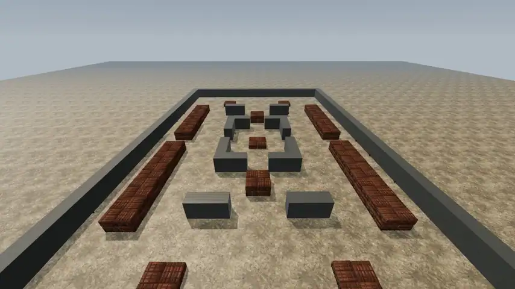
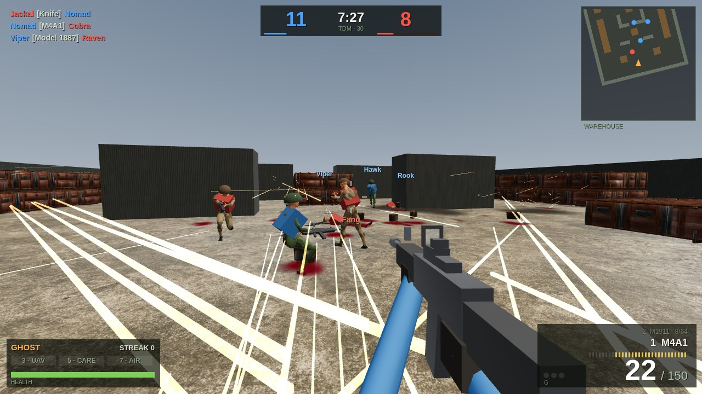
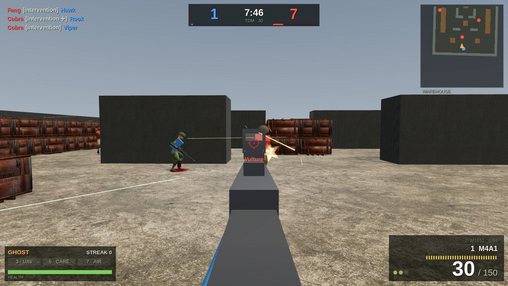
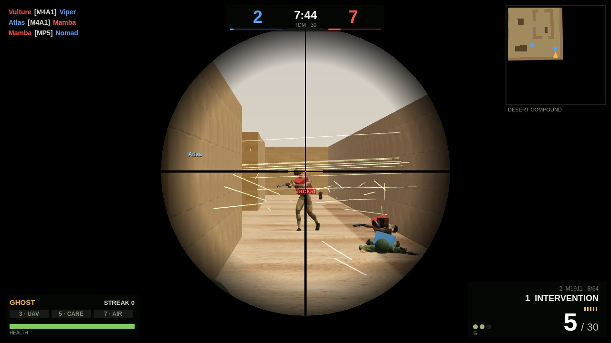
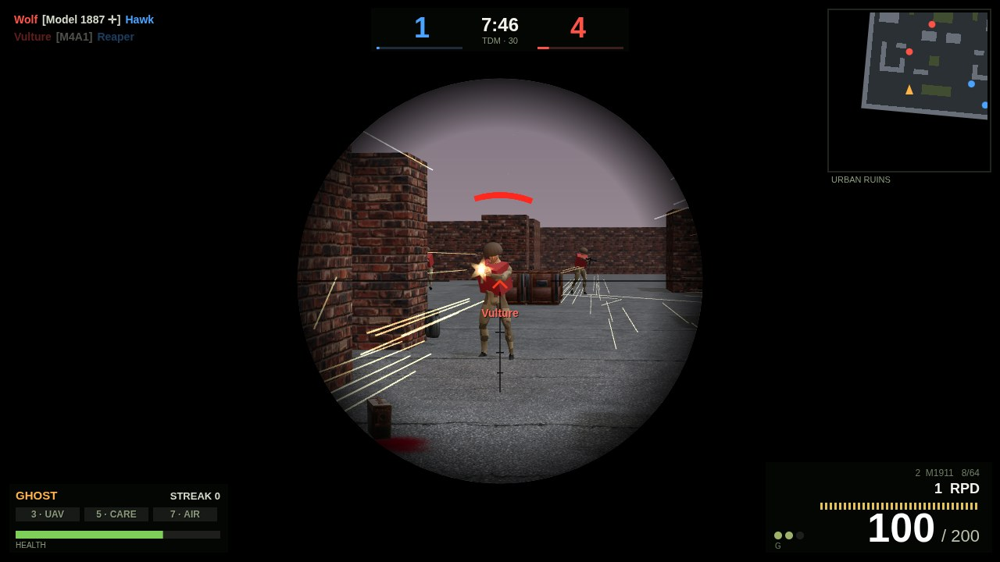
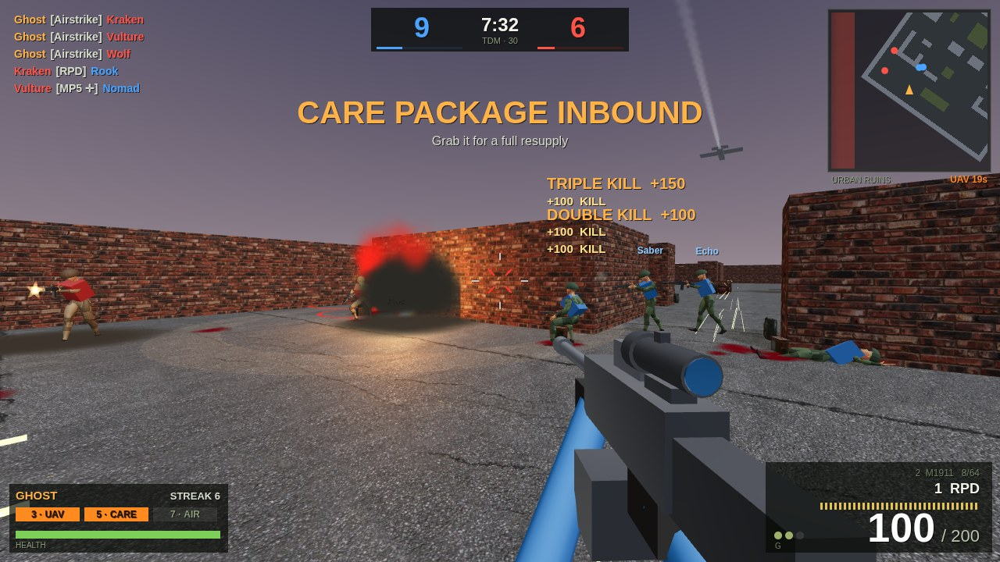
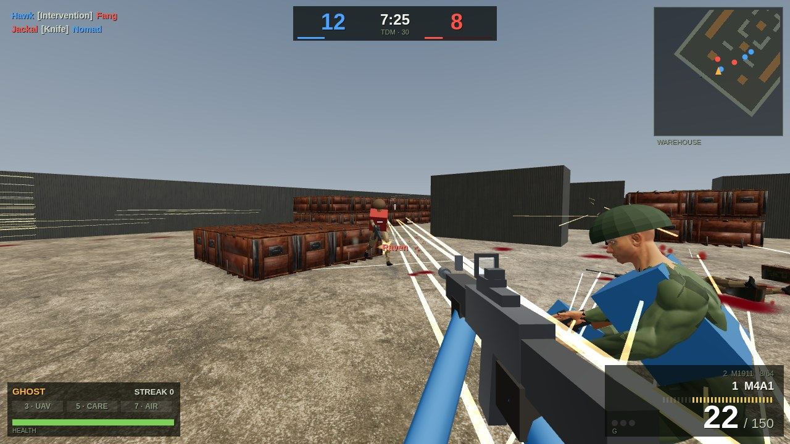
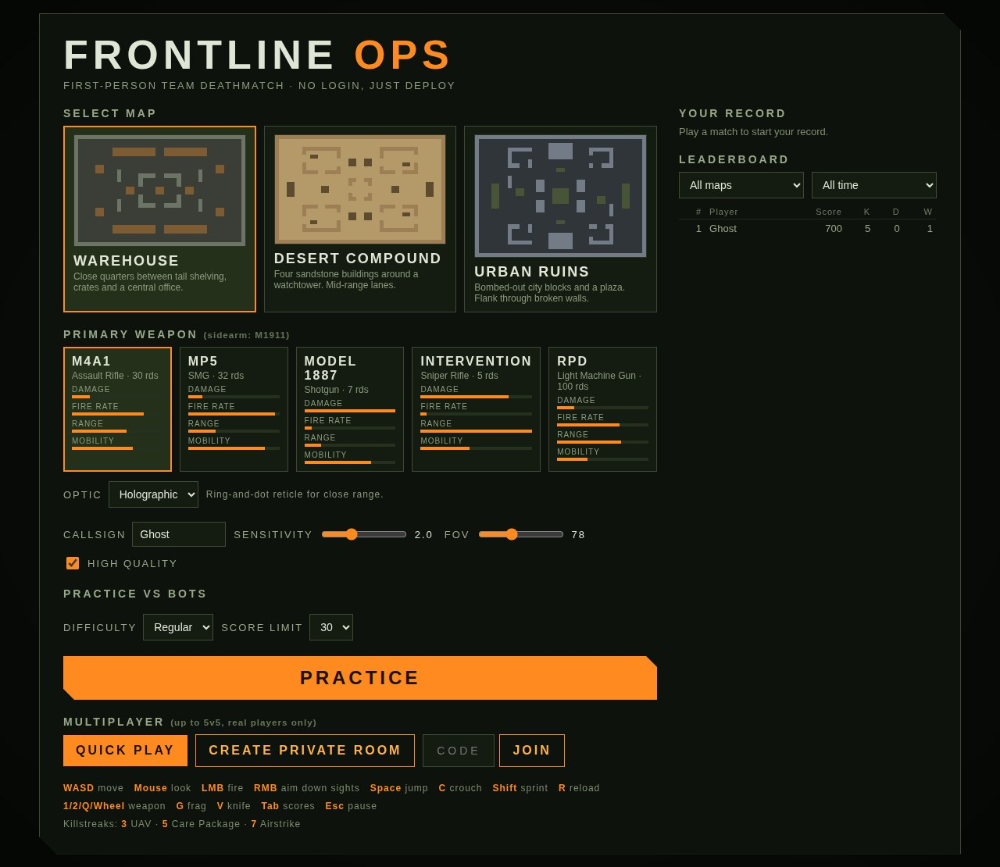

# Frontline Ops

**A first-person team deathmatch shooter you play right in your browser. No download, no account, no login.**

The 49-second trailer above plays by itself and has no sound. A sharper copy: [frontline-ops-trailer.mp4](docs/media/frontline-ops-trailer.mp4).

---

## The game

Frontline Ops is a fast, Call of Duty–style shooter. Two teams of five, **Rangers** and **OPFOR**, fight across three maps. The first team to reach the score limit wins. Pick a callsign, choose your gun and its optic, and deploy.

- Play **offline against bots** to practise, or **online with friends**. Online matches are real players only, with no bots.
- Every soldier is a fully animated human: they run, crouch, aim, reload and fall.
- Your health comes back if you stay out of the fight for a few seconds.
- Kill streaks earn rewards, and your results go on a **leaderboard**.

## Screenshots

<table>
  <tr>
    <td valign="top" width="50%"> <b>Warehouse firefight.</b> Both teams trade fire between the crate stacks.</td>
    <td valign="top" width="50%"> <b>Holographic sight.</b> Aiming down the M4A1's sight at an enemy who is firing back.</td>
  </tr>
  <tr>
    <td valign="top"> <b>Sniper Scope 8x.</b> Watching a lane in Desert Compound with the Intervention.</td>
    <td valign="top"> <b>ACOG 4x.</b> The RPD's ACOG on an enemy in Urban Ruins. The red arc shows where the shots are coming from.</td>
  </tr>
  <tr>
    <td valign="top"> <b>Airstrike.</b> The 7-kill streak reward: a jet bombs the enemy team.</td>
    <td valign="top"> <b>Animated soldiers.</b> A teammate pushes up beside you.</td>
  </tr>
</table>

## Getting started

1. Open the game in an up-to-date **Chrome, Edge or Firefox**. If you're hosting it yourself, run `docker compose up -d --build` and go to **http://localhost:8080**.
2. Type a **callsign** (your name in the game).
3. Choose a **map**, a **gun** and an **optic**.
4. Press **Practice** to play against bots, or use **Multiplayer** to play with people.
5. Click inside the game to take control of the mouse. Press **Esc** at any time to pause or leave.

Your profile is remembered by your browser, so there's nothing to sign up for.

The menu: pick a map, a gun and its optic, then press <b>Practice</b> or choose an online mode under <b>Multiplayer</b>.

## Game modes

| Mode | What it is |
| --- | --- |
| **Practice** | You and 4 bot teammates against 5 bots. Choose Recruit, Regular or Veteran bots and a score limit of 15, 30 or 50. |
| **Quick Play** | Join a public online match straight away, up to 5v5. Real players only: the match starts once someone is on each team. |
| **Private room** | Press **Create private room** to get a random 5-letter code. It's on your screen while you wait, and in the pause menu (**Esc**) with a **Copy** button. Friends type it next to **Join** to play in the same match. Real players only. |

A match ends when a team reaches the score limit or the 8-minute clock runs out. Online, the clock only runs while both teams have a player. If people leave and one team ends up two or more players bigger, a player from that team moves to the other side. Online matches then move on to the next map after a short break.

## Maps

| Map | Style |
| --- | --- |
| **Warehouse** | Close quarters between tall shelving, crate stacks and a central office. Great for SMGs and shotguns. |
| **Desert Compound** | Four sandstone buildings around a watchtower, with mid-range lanes in between. Good for rifles and snipers. |
| **Urban Ruins** | Bombed-out city blocks, broken walls to flank through, and an open plaza. |

Low cover such as crates and barrels lets you **crouch to hide** and **stand up to shoot over it**. Walls and tall stacks block everything.

## Weapons

| Gun | Type | Magazine | Best at |
| --- | --- | --- | --- |
| **M4A1** | Assault rifle | 30 | All-rounder, any range |
| **MP5** | SMG | 32 | Close range, moving fast |
| **Model 1887** | Shotgun | 7 | Very close range, one-shot power |
| **Intervention** | Sniper rifle | 5 | Long range, one-shot kills |
| **RPD** | Light machine gun | 100 | Holding a lane with sustained fire |
| **M1911** | Pistol (always carried) | 8 | Backup when you're out of ammo |

Every gun has its own damage, fire rate, range, recoil and reload time. **Headshots** do extra damage. The ammo counter shows your magazine and spare ammo, and walking over **ammo crates** or dropped ammo tops you up. You also carry **frag grenades** and a **knife** that kills in one hit.

## Optics and scopes

Each gun can carry a sight. Choose it under **Optic** in the menu; the game remembers your choice for each gun. Other players see the optic on your gun.

| Optic | Zoom | Reticle | Available on |
| --- | --- | --- | --- |
| **Iron Sights** | Slight | The gun's own sights | All guns |
| **Red Dot** | Slight | Red dot | M4A1, MP5, Model 1887, RPD |
| **Holographic** | Slight | Red ring with a dot, quick to read up close | M4A1, MP5, Model 1887, RPD |
| **ACOG 4x** | Strong (scope view) | Lit red chevron with range marks | M4A1, MP5, RPD, Intervention |
| **Sniper Scope 8x** | Very strong (scope view) | Fine crosshair | Intervention |

Scopes take a moment longer to raise, but let you pick off enemies far away. Aiming down sights also slows you down and tightens your shots.

## Kill streaks

Get kills without dying to earn rewards:

| Streak | Reward |
| --- | --- |
| **3 kills** | **UAV**: shows every enemy on your team's minimap for 30 seconds |
| **5 kills** | **Care Package**: a crate parachutes in; grab it for full ammo, grenades and health |
| **7 kills** | **Airstrike**: a jet bombs the enemy's positions (watch out for the red markers) |

Quick kills in a row also earn **Double**, **Triple** and **Fury** kill bonuses.

## Controls

| Key | Action |
| --- | --- |
| **W A S D** | Move |
| **Mouse** | Look around |
| **Left click** | Shoot |
| **Right click** | Aim down sights or scope in |
| **Space** | Jump |
| **C** | Crouch / stand up |
| **Shift** | Sprint |
| **R** | Reload |
| **1 / 2, Q or mouse wheel** | Switch between your gun and pistol |
| **G** | Throw a frag grenade |
| **V** | Knife |
| **Tab** | Scoreboard |
| **Esc** | Pause and free the mouse |

Mouse sensitivity, field of view and graphics quality can be changed in the menu.

## Tips

- **Aim for the head.** It's the fastest way to win a fight.
- **Crouch behind low cover** to reload safely, then stand to shoot over it.
- You can't shoot while sprinting, so stop sprinting before you round a corner.
- A red **!** on screen means an enemy grenade is near you. Move!
- Enemies who fire show up as **red dots on your minimap**. So do you.
- The red arcs around your crosshair point to whoever is hitting you.

## Your record

The menu shows your rank, score, wins, kills, K/D ratio and best streak. The **leaderboard** can be filtered by map and by today, this week or all time.

---

*Characters and animations by [Quaternius](https://quaternius.com); props and textures by [Poly Haven](https://polyhaven.com). All are free CC0 assets.*

*Developers: see [docs/DEVELOPMENT.md](docs/DEVELOPMENT.md).*
